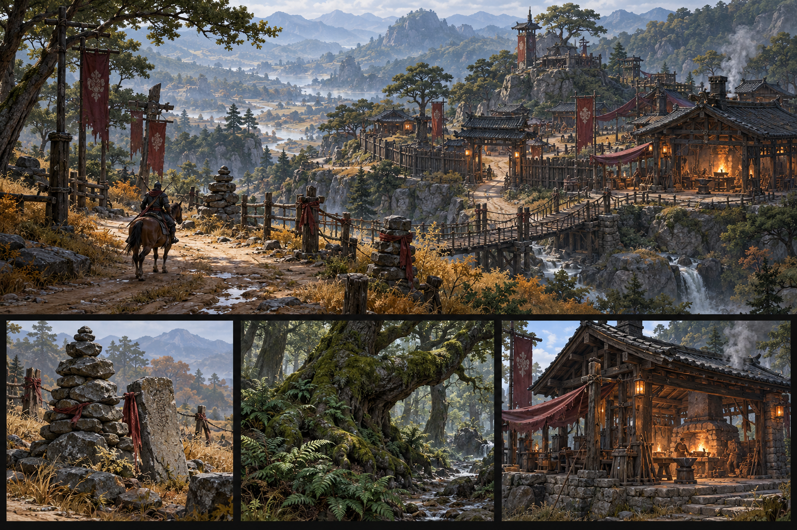

# Ironfield — game vision

**Design baseline · 3 October 2026.** User rules are fixed; numerical balance, new content and future features in these sheets are proposals. The existing Godot prototype remains the implementation baseline.

## The game

Ironfield is a third-person fantasy RPG built around outdoor hunting, increasingly efficient farming routes, dangerous equipment upgrades, and mastery earned by destroying hostile spawn points. Its world uses weathered Korean-inspired frontier architecture, inhabited roads, living roots, slate cairns, and restrained supernatural light.

The player leaves a refuge, chooses a hunting route, gathers trophies and rare gear, destroys a Fracture, and returns to town to prepare the next attempt. A stronger character can handle a larger pull, finish a route with fewer recovery stops, and take on a more dangerous Fracture. Skill timing and position should remain useful as damage increases.

## Design pillars

| Pillar | Player experience | Design consequence |
| --- | --- | --- |
| Tangible progress | A quarter of an XP bar gives a stat point | Four stat milestones per level, visible feedback and no lost awards |
| Dangerous smithing | A valuable item can be lost on a failed attempt | Exact odds and all costs visible before the attempt |
| Recognizable gear | Better tempering looks smoother and brighter | +7 blue sparks, +8 red sparks, +9 violet sparks on weapons and armor |
| Route knowledge | Similar-level hunts are the most rewarding | Logarithmic level-gap scaling applies in both directions |
| Skill mastery | Strong abilities require dangerous world farming | Rank 17 becomes M; Fracture loot advances mastery to G |
| Readable action | The player can see enemy commitments | Distinct silhouettes, short effects, visible hit areas and attack tells |

## Scope and progression

Proposed first release: levels 1–50, four base classes, two specializations per class, six abilities per specialization, four regions, and repeatable Fracture/boss routes. Current implementation includes Ironvow/Turnwarden, Briarwood March, Cinderfall Basin, town services, equipment, quests, and a trail horse. Other classes, higher mastery, the new stat allocation, +9 destruction rules, and later regions are design targets.

| Session length | Meaningful result |
| --- | --- |
| 10–15 minutes | Complete a hunt, gain a quarter-level stat point or gather an upgrade component |
| 30–45 minutes | Finish a farming circuit, attempt smithing, or destroy a Fracture |
| Several sessions | Master one ability, prepare replacement gear, unlock a harder route |
| Long term | Build several G abilities and +9 items without making earlier play obsolete |

## Fixed rules and assumptions

Every equippable item can reach +9. Consumables, quest objects and materials are not equipment. Failure destroys the selected equipment and spends the attempt costs. Higher gear tiers have lower success rates. There is no preservation scroll, guaranteed Wakeglass upgrade, or recovery of the destroyed item in this target design.

The two mastery tiers are **M** and **G**. This does not limit a character to two mastered skills. The interpretation of M1–M10 costs, level cap, stat formulas, gear tier boundaries, and loot scaling is stated explicitly in the relevant sheets and can be tuned.

## Documents and deliverables

Use the [illustrated index](../index.html) for browsing, [balance workbook](../Ironfield_Concepts.xlsx) for editing tables, and individual Markdown sheets for design review. CSV tables and `design_rules.json` preserve the numeric rules. Concept plates describe intended appearances; they are generated illustrations, not imported runtime models or screenshots.

Future multiplayer, trading, guilds and PvP are described as proposals in [endgame and online play](15_endgame_and_online.md). The current project is an offline prototype.
