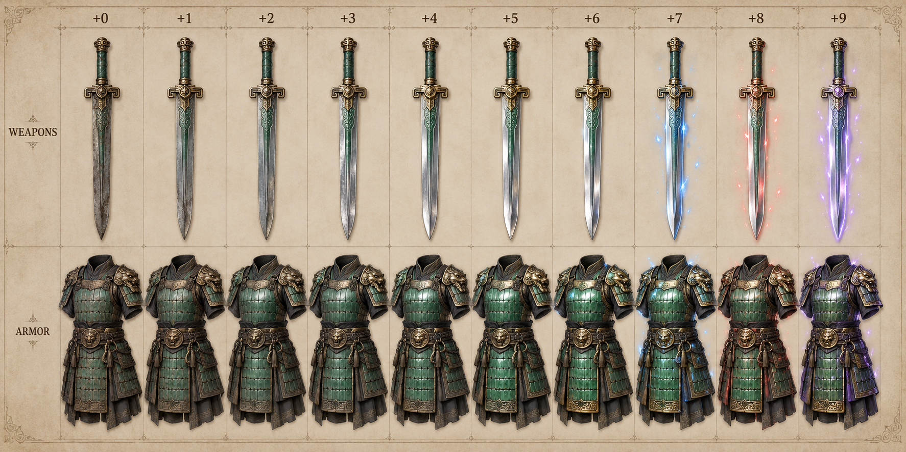

# Equipment, tiers and visual progression

## Equipment scope

Every weapon, chest piece, helmet, boots, gloves, shield and stat accessory has a +0–+9 upgrade track. The current prototype mainly exposes weapon/chest equipment and several additional gear items; full slot coverage is a future target. Horse tack with equipment stats follows this rule if added. A horse unlock token, material or potion is not an upgradeable equipment item.

| Tier | Proposed requirement band | Material language | Example sword progression |
| --- | --- | --- | --- |
| T1 | 1–5 | Worn steel, cloth padding, plain leather | Wayfarer / Field Blade |
| T2 | 6–10 | Brushed steel, fitted leather, small jade detail | Marchguard / Woodland Steel |
| T3 | 11–15 | Layered steel, slate ornament, sturdier construction | Briarsteel / Highland Steel |
| T4 | 16–20 | Lamellar, brass trim, engraved reinforced steel | Cairnwarden / Ashen Steel |
| T5 | 21+ | Distinct relic forms and fine fitted metalwork | Wakecleaver / Ancient Relic |

Level requirement and tier are separate from rarity. Rarity supplies additional base strength or an affix; upgrade level multiplies only the item's upgradeable base stats. All gear in a tier keeps that tier's smithing odds, including rare gear.

## Stat and surface progression

| Upgrade | Base-stat multiplier | Metal roughness target | Appearance |
| --- | ---: | ---: | --- |
| +0 | 1.00× | .85 | Matte, worn, no sparks |
| +1 | 1.04× | .80 | Slightly cleaner edges |
| +2 | 1.09× | .73 | Softer surface scratches |
| +3 | 1.15× | .65 | Broader controlled reflections |
| +4 | 1.22× | .56 | Brushed polished edges |
| +5 | 1.30× | .46 | Distinct shine on exposed metal |
| +6 | 1.40× | .36 | Bright tempered steel |
| +7 | 1.52× | .28 | Blue sparks |
| +8 | 1.66× | .21 | Red sparks |
| +9 | 1.82× | .16 | Violet sparks |

Use the same geometry throughout one item's track. Upgrade level must not enlarge a sword, armor shoulder, horse or character. Steel metallic is approximately .85; cloth and leather remain nonmetallic and retain their natural surface response. Shine increases on metallic armor plates, buckles and rivets. A cloth robe must still look like cloth.

The modifier is relative to the original item's base stats, not the previous + step. A 34-attack sword at +9 contributes `34 × 1.82 = 61.88` attack before final display rounding; do not compound the multipliers or apply them to the character's total attack. Armor uses the same multiplier on its base Defense and HP bonuses. Affix values, level requirements and movement penalties stay separately defined.

## Spark rule by gear tier

Every tier starts blue at +7, changes to red at +8, and violet at +9. Gear tier scales density: T1 **1.00×**, T2 **1.15×**, T3 **1.30×**, T4 **1.50×**, T5 **1.75×**. Tier may also change emission placement and ornament detail; it must not reorder the colours or start violet early.

Place short sparks along the blade edge, guard, armor seams and shoulders. Keep particle life short, avoid persistent opaque shells, and reduce density when many players are visible. Accessories show their + level in their icon and tooltip; visible pendants can emit a very small matching accent.

## Acquisition and replacement

Town sells dependable ordinary equipment for each available band. Ordinary mobs supply materials and rare relic drops. Camp leaders and Fractures provide distinct chase gear. A stronger tier at modest + should be a sensible alternative to gambling an older valuable item; required farming routes must remain playable with ordinary well-prepared gear.

The [equipment table](../tables/equipment_catalogue.csv) contains all current equipment resources and proposed upgrade/tier fields. New classes need distinct rods, needles, hammers, staves, bows and short blades using the same nine-step visual rules.
