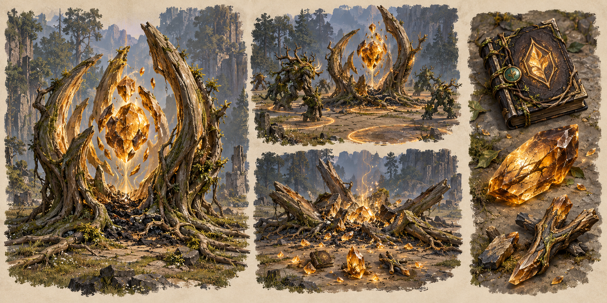

# Skill points and the M / G mastery path

**Fixed:** one skill point per level; rank 17 becomes M; mastery loot comes from destroying spawn points; M10 completes G. **Interpretation:** M and G are two mastery tiers, and each successive M rank costs that rank's number of loot items.

## Basic skill ranks

Each specialization has six abilities. A new character receives one proposed starting skill point, then one point per level gained. Spend one point to learn rank 1 of an ability, then one point per rank up to 17. Rank 17 is displayed as **M**, the first mastery tier. There is no random early promotion between ranks 17 and 20.

Basic attacks remain available without skill investment. A point gives one rank to one ability; it is not spread across all six. Six abilities each require 17 basic points to reach M, for 102 total. With a proposed level cap of 50 and 50 total points, players choose a focused build rather than mastering all six in the first release. There is no explicit two-skill mastery limit.

## Mastery loot costs

The proposed special item is **Mastery Leaf**, a dark bound leaf/tome fragment recovered from the destroyed core of a Fracture. It is not ordinary defender loot. The learning process is deterministic: enough loot grants the next rank, with 100% learning success and no cooldown or additional skill-point cost.

| Transition | Leaves consumed | Total leaves invested | Skill points invested |
| --- | ---: | ---: | ---: |
| Rank 16 → M | 0 | 0 | 17 |
| M → M1 | 1 | 1 | 17 |
| M1 → M2 | 2 | 3 | 17 |
| M2 → M3 | 3 | 6 | 17 |
| M3 → M4 | 4 | 10 | 17 |
| M4 → M5 | 5 | 15 | 17 |
| M5 → M6 | 6 | 21 | 17 |
| M6 → M7 | 7 | 28 | 17 |
| M7 → M8 | 8 | 36 | 17 |
| M8 → M9 | 9 | 45 | 17 |
| M9 → M10 → G | 10 | 55 | 17 |

G is the final mastery display state, with M10 stored as the underlying completed rank. There is no extra item cost for changing the label to G, no G1–G10 track and no third mastery tier. Insufficient materials or an ability below M cannot consume a Leaf. Use an atomic spend-and-learn transaction.

## Proposed rank strength

Rank-1 potency is the baseline. Basic rank r gives `1 + 0.02 × (r − 1)` potency, reaching 1.32× at M. M stage k gives `1.32 + 0.03 × k`, reaching 1.62× at M10/G. Apply potency to the listed damage/heal/shield values once. Cooldown, dash distance, duration, area size, crowd-control duration and movement bonuses stay unchanged unless a skill explicitly lists a bounded mastery bonus.

A 180%-Attack rank-1 cleave becomes 237.6% at M and 291.6% at G before DEX, gear and target mitigation. A rank without a numeric potency effect still records mastery, but needs an explicit reviewed utility benefit before implementation; do not silently enlarge Flashstep's travel distance or give invulnerability.

The [mastery table](../tables/skill_mastery.csv) lists every basic rank and M step. Existing prototype skill values have no investment track; treat them as rank-1 comparison values for this proposal.

## Skill reset and persistence

Outside combat, a gold-funded skill reset can return allocated basic points. Learned mastery remains attached to that skill but dormant until 17 basic points are assigned to it again. Leaves are never refunded or transferable to another skill through a reset. Store the persistent skill ID, basic rank, mastery rank, earned skill-point total and unspent balance.

Show **next rank cost**, **owned Leaves**, **current/next effect**, and **maximum reached** in the skill panel. A G skill cannot accept more items. Resetting or switching UI pages must never duplicate points or loot.
