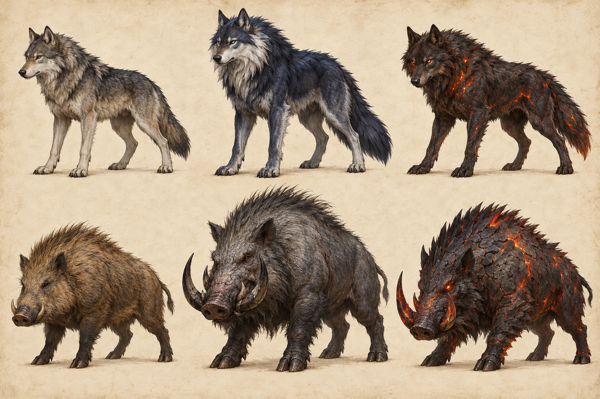
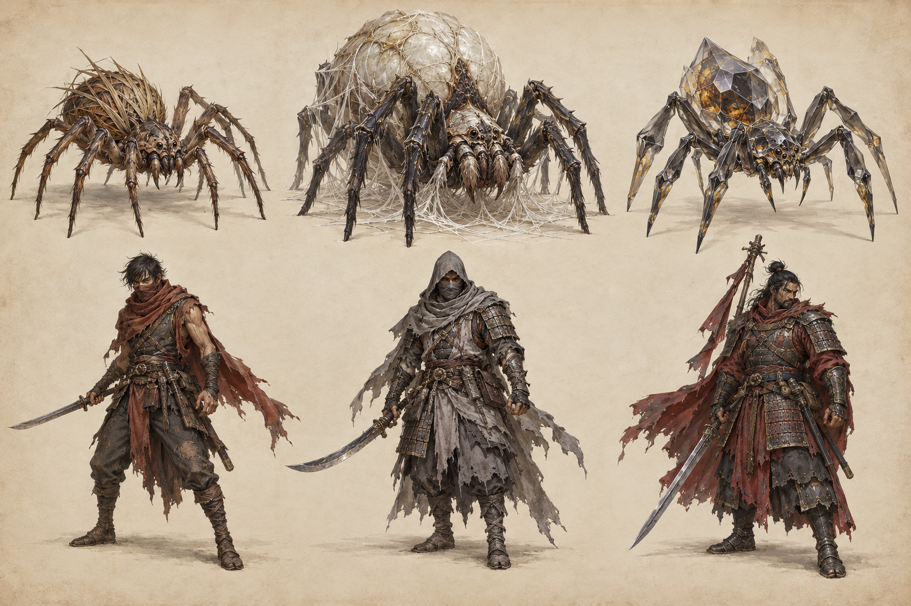
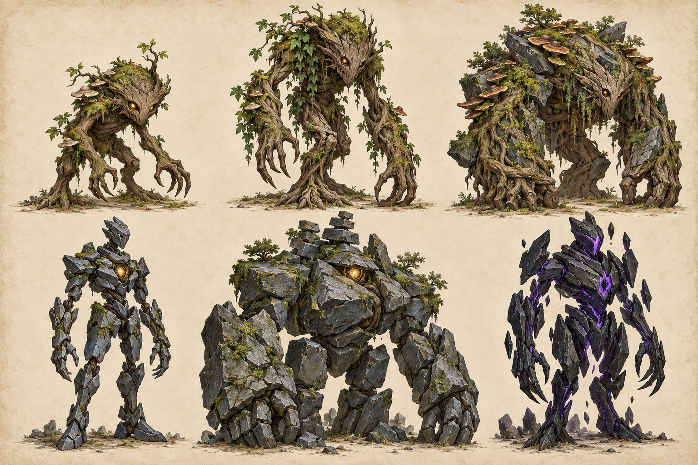
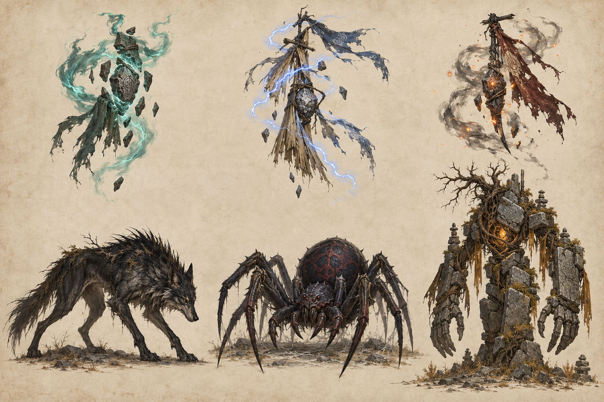
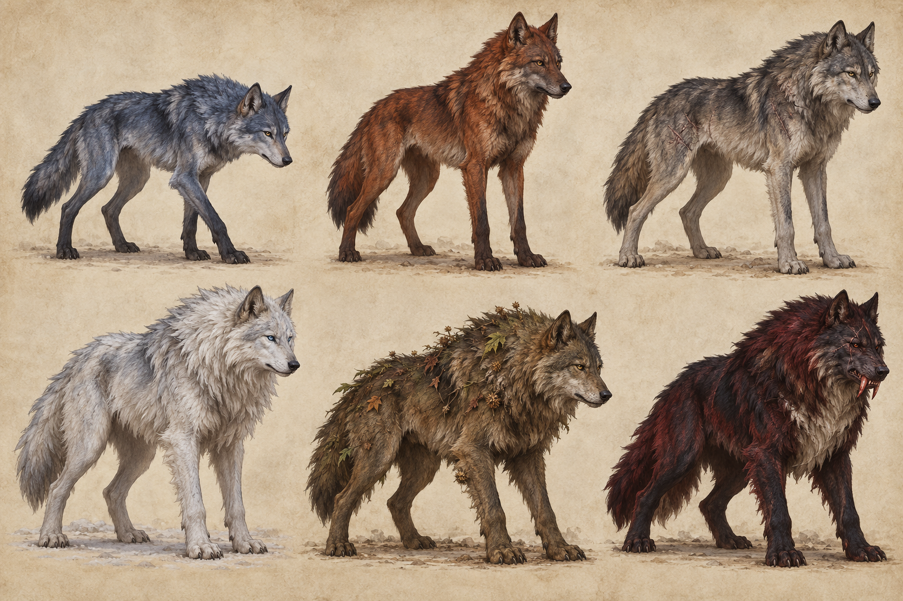
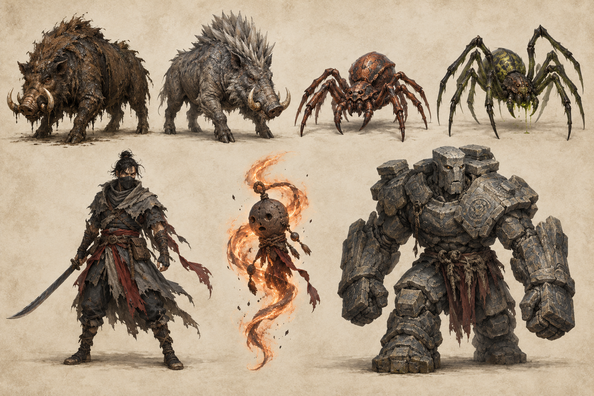

# Mob bestiary — concepts, levels, EXP and drops

**Current resource baseline:** 37 unique mob IDs across 38 enemy resources. `young_mosslings.tres` aliases `young.tres`; it is not a second creature. Art describes the intended model direction; numerical rows reproduce the current resources. Proposed logarithmic scaling is applied separately.

Use the [illustrated mob cards](../bestiary.html) for a portrait, stats and full drop list on every creature. [mobs.csv](../tables/mobs.csv) and [mob_drops.csv](../tables/mob_drops.csv) are the editable tables. The source catalogue JSON still contains some older rates: runtime `.tres` drop resources are the baseline here.

## Threat tiers

| Tier | Proposed encounter reading |
| --- | --- |
| T1 | Ordinary pack enemy |
| T2 | Stronger pack / dangerous individual |
| T3 | Elite or local leader |
| T4 | Major boss or regional threat |
| T5 | Regional climax / future group variant |

Tier and level are separate. A level-8 T3 leader can be tougher than a level-9 ordinary creature. The current prototype has no online raid system. Base EXP is not secretly changed by the proposed item-drop function.

## Concept plates

Panels are numbered left to right across the top row, then left to right across the bottom. The remaining-variants sheet has four top panels and three bottom panels; all other bestiary sheets use three per row.

### Wolves Boars

1: Meadow Wolf; 2: Moonfang; 3: Ember Hound; 4: Bristle Boar; 5: Blacktusk Boar; 6: Obsidian Boar.

### Spiders Bandits

1: Reed Spider; 2: Silk Matron; 3: Glass Spider; 4: Road Bandit; 5: Hollow Raider; 6: Exile Captain.

### Roots Stone

1: Young Mossling; 2: Mossling; 3: Cairn Ironback; 4: Cairn Sentinel; 5: Cairn Colossus; 6: Rift Sentinel.

### Wisps Elites

1: Grave Wisp; 2: Storm Wisp; 3: Ash Wisp; 4: Dusk Stalker; 5: Widow Spider; 6: Ancient Warden.

### Wolf Variants

1: Blue Wolf; 2: Red Wolf; 3: Grey Wolf; 4: Frost Wolf; 5: Thicket Wolf; 6: Bloodfang.

### Remaining Variants

1: Mire Boar; 2: Ironhide Boar; 3: Copper Spider; 4: Venom Spider; 5: Ash Bandit; 6: Cinder Wisp; 7: Slate Guardian.

## Creature catalogue

All item rates below are independent, equal-level base chances. Multiply each by the factor in [loot scaling](06_loot_and_level_scaling.md). Several entries can succeed on one kill. Gold is a separate uniformly rolled reward before the proposed multiplier.

Cinderfall variants deliberately reuse existing drop resources: Ember Hound uses Bloodfang loot, Glass Spider uses Venom Spider loot, Ash Wisp uses Grave Wisp loot, and Rift Sentinel uses Cairn Sentinel loot. Keep those names accurate until distinct loot is authored. Current enemy resources have no configured direct leader reward; old fixture camps may still grant one and must be treated separately.

### Meadow Wolf (`meadow_wolf`)

**Level 1 · Tier 1 · 20 EXP · 83 HP · Defense 0.22 · Gold 4–10. Family: wolf.

Appearance: Lean grey-brown pelt; small low-tier silhouette. [Concept plate, panel 1](../art/bestiary_wolves_boars.png).

| Item | Base drop chance | Quantity on successful roll |
| --- | ---: | ---: |
| Meadow Wolf Fang (`meadow_wolf_trophy`) | 22.5% | 1 |
| Field tonic (`field_tonic`) | 4% | 1 |
| Verge Relic Blade (`relic_blade_1`) | 0.2% | 1 |
| Verge Relic Coat (`relic_coat_1`) | 0.2% | 1 |

Source: `game/data/enemies/meadow_wolf.tres`; drop table `res://data/drops/meadow_wolf.tres`.

### Young Mossling (`young`)

**Level 1 · Tier 1 · 20 EXP · 60 HP · Defense 0 · Gold 4–6. Family: mossling.

Appearance: Small hunched root body, split feet, amber eyes. [Concept plate, panel 1](../art/bestiary_roots_stone.png).

| Item | Base drop chance | Quantity on successful roll |
| --- | ---: | ---: |
| Moss shard (`moss_shard`) | 45% | 1 |
| Field tonic (`field_tonic`) | 4% | 1 |
| Verge Relic Blade (`relic_blade_1`) | 0.2% | 1 |
| Verge Relic Coat (`relic_coat_1`) | 0.2% | 1 |
| Young Mossling Sap (`young_trophy`) | 22.5% | 1 |

Source: `game/data/enemies/young.tres`; drop table `res://data/drops/young.tres`.

### Bristle Boar (`bristle_boar`)

**Level 2 · Tier 1 · 28 EXP · 101 HP · Defense 0.44 · Gold 6–13. Family: boar.

Appearance: Tawny bristles, compact body, short tusks. [Concept plate, panel 4](../art/bestiary_wolves_boars.png).

| Item | Base drop chance | Quantity on successful roll |
| --- | ---: | ---: |
| Bristle Boar Tusk (`bristle_boar_trophy`) | 22.5% | 1 |
| Field tonic (`field_tonic`) | 4% | 1 |
| Verge Relic Blade (`relic_blade_1`) | 0.2% | 1 |
| Verge Relic Coat (`relic_coat_1`) | 0.2% | 1 |

Source: `game/data/enemies/bristle_boar.tres`; drop table `res://data/drops/bristle_boar.tres`.

### Blue Wolf (`blue_wolf`)

**Level 3 · Tier 1 · 36 EXP · 119 HP · Defense 0.66 · Gold 8–16. Family: wolf.

Appearance: Small blue-grey coat with dark paws. [Concept plate, panel 1](../art/bestiary_wolf_variants.png).

| Item | Base drop chance | Quantity on successful roll |
| --- | ---: | ---: |
| Blue Wolf Fang (`blue_wolf_trophy`) | 22.5% | 1 |
| Field tonic (`field_tonic`) | 4% | 1 |
| Verge Relic Blade (`relic_blade_1`) | 0.2% | 1 |
| Verge Relic Coat (`relic_coat_1`) | 0.2% | 1 |

Source: `game/data/enemies/blue_wolf.tres`; drop table `res://data/drops/blue_wolf.tres`.

### Mossling (`grown`)

**Level 4 · Tier 1 · 25 EXP · 75 HP · Defense 0 · Gold 6–8. Family: mossling.

Appearance: Long knotty arms, ivy, taller root silhouette. [Concept plate, panel 2](../art/bestiary_roots_stone.png).

| Item | Base drop chance | Quantity on successful roll |
| --- | ---: | ---: |
| Moss shard (`moss_shard`) | 35% | 1 |
| Field tonic (`field_tonic`) | 4% | 1 |
| Verge Relic Blade (`relic_blade_1`) | 0.2% | 1 |
| Verge Relic Coat (`relic_coat_1`) | 0.2% | 1 |
| Grown Mossling Bark (`grown_trophy`) | 22.5% | 1 |

Source: `game/data/enemies/grown.tres`; drop table `res://data/drops/grown.tres`.

### Reed Spider (`reed_spider`)

**Level 4 · Tier 1 · 44 EXP · 137 HP · Defense 0.88 · Gold 10–19. Family: spider.

Appearance: Brown reed carapace; slender eight-legged stance. [Concept plate, panel 1](../art/bestiary_spiders_bandits.png).

| Item | Base drop chance | Quantity on successful roll |
| --- | ---: | ---: |
| Reed Spider Silk (`reed_spider_trophy`) | 22.5% | 1 |
| Field tonic (`field_tonic`) | 4% | 1 |
| Verge Relic Blade (`relic_blade_1`) | 0.2% | 1 |
| Verge Relic Coat (`relic_coat_1`) | 0.2% | 1 |

Source: `game/data/enemies/reed_spider.tres`; drop table `res://data/drops/reed_spider.tres`.

### Red Wolf (`red_wolf`)

**Level 5 · Tier 2 · 62 EXP · 209 HP · Defense 1.9 · Gold 12–25. Family: wolf.

Appearance: Copper coat, alert ears, charcoal muzzle. [Concept plate, panel 2](../art/bestiary_wolf_variants.png).

| Item | Base drop chance | Quantity on successful roll |
| --- | ---: | ---: |
| Red Wolf Fang (`red_wolf_trophy`) | 22.5% | 1 |
| Field tonic (`field_tonic`) | 4% | 1 |
| Verge Relic Blade (`relic_blade_1`) | 0.25% | 1 |
| Verge Relic Coat (`relic_coat_1`) | 0.25% | 1 |

Source: `game/data/enemies/red_wolf.tres`; drop table `res://data/drops/red_wolf.tres`.

### Grey Wolf (`grey_wolf`)

**Level 6 · Tier 1 · 60 EXP · 173 HP · Defense 1.32 · Gold 14–25. Family: wolf.

Appearance: Rangy slate coat with pale belly and fur scars. [Concept plate, panel 3](../art/bestiary_wolf_variants.png).

| Item | Base drop chance | Quantity on successful roll |
| --- | ---: | ---: |
| Grey Wolf Fang (`grey_wolf_trophy`) | 22.5% | 1 |
| Restoration Tonic (`restoration_tonic`) | 8% | 1 |
| Hollow Relic Blade (`relic_blade_6`) | 0.2% | 1 |
| Hollow Relic Coat (`relic_coat_6`) | 0.2% | 1 |

Source: `game/data/enemies/grey_wolf.tres`; drop table `res://data/drops/grey_wolf.tres`.

### Cairn Ironback (`ironback`)

**Level 7 · Tier 2 · 40 EXP · 110 HP · Defense 0 · Gold 9–12. Family: mossling.

Appearance: Heavy bark shoulders, wedged slate, shelf fungus. [Concept plate, panel 3](../art/bestiary_roots_stone.png).

| Item | Base drop chance | Quantity on successful roll |
| --- | ---: | ---: |
| Moss shard (`moss_shard`) | 35% | 1 |
| Field tonic (`field_tonic`) | 4% | 1 |
| Verge Relic Blade (`relic_blade_1`) | 0.2% | 1 |
| Verge Relic Coat (`relic_coat_1`) | 0.2% | 1 |
| Ironback Plate (`ironback_trophy`) | 22.5% | 1 |

Source: `game/data/enemies/ironback.tres`; drop table `res://data/drops/ironback.tres`.

### Mire Boar (`mire_boar`)

**Level 7 · Tier 2 · 82 EXP · 258 HP · Defense 2.34 · Gold 16–31. Family: boar.

Appearance: Low muddy brown body and bent pale tusks. [Concept plate, panel 1](../art/bestiary_remaining_variants.png).

| Item | Base drop chance | Quantity on successful roll |
| --- | ---: | ---: |
| Mire Boar Tusk (`mire_boar_trophy`) | 22.5% | 1 |
| Restoration Tonic (`restoration_tonic`) | 8% | 1 |
| Hollow Relic Blade (`relic_blade_6`) | 0.25% | 1 |
| Hollow Relic Coat (`relic_coat_6`) | 0.25% | 1 |

Source: `game/data/enemies/mire_boar.tres`; drop table `res://data/drops/mire_boar.tres`.

### Copper Spider (`copper_spider`)

**Level 8 · Tier 1 · 76 EXP · 209 HP · Defense 1.76 · Gold 18–31. Family: spider.

Appearance: Copper-brown chitin and compact abdomen. [Concept plate, panel 3](../art/bestiary_remaining_variants.png).

| Item | Base drop chance | Quantity on successful roll |
| --- | ---: | ---: |
| Copper Spider Silk (`copper_spider_trophy`) | 22.5% | 1 |
| Restoration Tonic (`restoration_tonic`) | 8% | 1 |
| Hollow Relic Blade (`relic_blade_6`) | 0.2% | 1 |
| Hollow Relic Coat (`relic_coat_6`) | 0.2% | 1 |

Source: `game/data/enemies/copper_spider.tres`; drop table `res://data/drops/copper_spider.tres`.

### Moonfang (`moonfang`)

**Level 8 · Tier 3 · 152 EXP · 522 HP · Defense 3.36 · Gold 18–37. Family: wolf.

Appearance: Midnight blue coat, pale cheek mane; larger pack leader. [Concept plate, panel 2](../art/bestiary_wolves_boars.png).

| Item | Base drop chance | Quantity on successful roll |
| --- | ---: | ---: |
| Moonfang Fang (`moonfang_trophy`) | 22.5% | 1–2 |
| Restoration Tonic (`restoration_tonic`) | 8% | 1 |
| Hollow Relic Blade (`relic_blade_6`) | 0.3% | 1 |
| Hollow Relic Coat (`relic_coat_6`) | 0.3% | 1 |

Source: `game/data/enemies/moonfang.tres`; drop table `res://data/drops/moonfang.tres`.

### Road Bandit (`road_bandit`)

**Level 9 · Tier 2 · 101 EXP · 306 HP · Defense 2.78 · Gold 20–37. Family: bandit.

Appearance: Russet wraps, patched leather, short steel blade. [Concept plate, panel 4](../art/bestiary_spiders_bandits.png).

| Item | Base drop chance | Quantity on successful roll |
| --- | ---: | ---: |
| Road Bandit Insignia (`road_bandit_trophy`) | 22.5% | 1 |
| Restoration Tonic (`restoration_tonic`) | 8% | 1 |
| Hollow Relic Blade (`relic_blade_6`) | 0.25% | 1 |
| Hollow Relic Coat (`relic_coat_6`) | 0.25% | 1 |

Source: `game/data/enemies/road_bandit.tres`; drop table `res://data/drops/road_bandit.tres`.

### Thicket Wolf (`thicket_wolf`)

**Level 10 · Tier 1 · 92 EXP · 245 HP · Defense 2.2 · Gold 22–37. Family: wolf.

Appearance: Olive-brown bristles with caught burrs and leaves. [Concept plate, panel 5](../art/bestiary_wolf_variants.png).

| Item | Base drop chance | Quantity on successful roll |
| --- | ---: | ---: |
| Thicket Wolf Fang (`thicket_wolf_trophy`) | 22.5% | 1 |
| Restoration Tonic (`restoration_tonic`) | 8% | 1 |
| Hollow Relic Blade (`relic_blade_6`) | 0.2% | 1 |
| Hollow Relic Coat (`relic_coat_6`) | 0.2% | 1 |

Source: `game/data/enemies/thicket_wolf.tres`; drop table `res://data/drops/thicket_wolf.tres`.

### Blacktusk Boar (`blacktusk`)

**Level 11 · Tier 2 · 120 EXP · 355 HP · Defense 3.22 · Gold 24–43. Family: boar.

Appearance: Grey-black hide, strong shoulders, chipped black tusks. [Concept plate, panel 5](../art/bestiary_wolves_boars.png).

| Item | Base drop chance | Quantity on successful roll |
| --- | ---: | ---: |
| Blacktusk Boar Tusk (`blacktusk_trophy`) | 22.5% | 1 |
| Restoration Tonic (`restoration_tonic`) | 8% | 1 |
| Highland Relic Blade (`relic_blade_11`) | 0.25% | 1 |
| Highland Relic Coat (`relic_coat_11`) | 0.25% | 1 |

Source: `game/data/enemies/blacktusk.tres`; drop table `res://data/drops/blacktusk.tres`.

### Venom Spider (`venom_spider`)

**Level 12 · Tier 2 · 130 EXP · 379 HP · Defense 3.44 · Gold 26–46. Family: spider.

Appearance: Olive-black carapace, narrow green fang droplets. [Concept plate, panel 4](../art/bestiary_remaining_variants.png).

| Item | Base drop chance | Quantity on successful roll |
| --- | ---: | ---: |
| Venom Spider Silk (`venom_spider_trophy`) | 22.5% | 1 |
| Restoration Tonic (`restoration_tonic`) | 8% | 1 |
| Highland Relic Blade (`relic_blade_11`) | 0.25% | 1 |
| Highland Relic Coat (`relic_coat_11`) | 0.25% | 1 |

Source: `game/data/enemies/venom_spider.tres`; drop table `res://data/drops/venom_spider.tres`.

### Slate Guardian (`slate_guardian`)

**Level 12 · Tier 3 · 216 EXP · 702 HP · Defense 4.24 · Gold 26–49. Family: stonekin.

Appearance: Squared shoulders, etched pale face stone, heavy hands. [Concept plate, panel 7](../art/bestiary_remaining_variants.png).

| Item | Base drop chance | Quantity on successful roll |
| --- | ---: | ---: |
| Slate Guardian Core (`slate_guardian_trophy`) | 22.5% | 1–2 |
| Restoration Tonic (`restoration_tonic`) | 8% | 1 |
| Highland Relic Blade (`relic_blade_11`) | 0.3% | 1 |
| Highland Relic Coat (`relic_coat_11`) | 0.3% | 1 |

Source: `game/data/enemies/slate_guardian.tres`; drop table `res://data/drops/slate_guardian.tres`.

### Hollow Raider (`hollow_raider`)

**Level 13 · Tier 1 · 116 EXP · 299 HP · Defense 2.86 · Gold 28–46. Family: bandit.

Appearance: Grey hood, patched lamellar, curved blade. [Concept plate, panel 5](../art/bestiary_spiders_bandits.png).

| Item | Base drop chance | Quantity on successful roll |
| --- | ---: | ---: |
| Hollow Raider Insignia (`hollow_raider_trophy`) | 22.5% | 1 |
| Restoration Tonic (`restoration_tonic`) | 8% | 1 |
| Highland Relic Blade (`relic_blade_11`) | 0.2% | 1 |
| Highland Relic Coat (`relic_coat_11`) | 0.2% | 1 |

Source: `game/data/enemies/hollow_raider.tres`; drop table `res://data/drops/hollow_raider.tres`.

### Cinder Wisp (`cinder_wisp`)

**Level 14 · Tier 1 · 124 EXP · 317 HP · Defense 3.08 · Gold 30–49. Family: wisp.

Appearance: Burned clay charm and narrow copper flame ribbon. [Concept plate, panel 6](../art/bestiary_remaining_variants.png).

| Item | Base drop chance | Quantity on successful roll |
| --- | ---: | ---: |
| Cinder Wisp Essence (`cinder_wisp_trophy`) | 22.5% | 1 |
| Restoration Tonic (`restoration_tonic`) | 8% | 1 |
| Highland Relic Blade (`relic_blade_11`) | 0.2% | 1 |
| Highland Relic Coat (`relic_coat_11`) | 0.2% | 1 |

Source: `game/data/enemies/cinder_wisp.tres`; drop table `res://data/drops/cinder_wisp.tres`.

### Frost Wolf (`frost_wolf`)

**Level 15 · Tier 2 · 158 EXP · 452 HP · Defense 4.1 · Gold 32–55. Family: wolf.

Appearance: White-grey coat, thick neck ruff, pale blue eyes. [Concept plate, panel 4](../art/bestiary_wolf_variants.png).

| Item | Base drop chance | Quantity on successful roll |
| --- | ---: | ---: |
| Frost Wolf Fang (`frost_wolf_trophy`) | 22.5% | 1 |
| Restoration Tonic (`restoration_tonic`) | 8% | 1 |
| Highland Relic Blade (`relic_blade_11`) | 0.25% | 1 |
| Highland Relic Coat (`relic_coat_11`) | 0.25% | 1 |

Source: `game/data/enemies/frost_wolf.tres`; drop table `res://data/drops/frost_wolf.tres`.

### Ironhide Boar (`ironhide_boar`)

**Level 16 · Tier 1 · 140 EXP · 353 HP · Defense 3.52 · Gold 34–55. Family: boar.

Appearance: Rough grey hide, broad iron-coloured bristle ridge. [Concept plate, panel 2](../art/bestiary_remaining_variants.png).

| Item | Base drop chance | Quantity on successful roll |
| --- | ---: | ---: |
| Ironhide Boar Tusk (`ironhide_boar_trophy`) | 22.5% | 1 |
| Greater Tonic (`greater_tonic`) | 8% | 1 |
| Ashen Relic Blade (`relic_blade_16`) | 0.2% | 1 |
| Ashen Relic Coat (`relic_coat_16`) | 0.2% | 1 |

Source: `game/data/enemies/ironhide_boar.tres`; drop table `res://data/drops/ironhide_boar.tres`.

### Silk Matron (`silk_matron`)

**Level 16 · Tier 4 · 420 EXP · 1341 HP · Defense 5.92 · Gold 34–64. Family: spider.

Appearance: Pale bulky abdomen, broad stance, silk drapery. [Concept plate, panel 2](../art/bestiary_spiders_bandits.png).

| Item | Base drop chance | Quantity on successful roll |
| --- | ---: | ---: |
| Silk Matron Silk (`silk_matron_trophy`) | 22.5% | 1–2 |
| Greater Tonic (`greater_tonic`) | 8% | 1 |
| Ashen Relic Blade (`relic_blade_16`) | 0.35% | 1 |
| Ashen Relic Coat (`relic_coat_16`) | 0.35% | 1 |

Source: `game/data/enemies/silk_matron.tres`; drop table `res://data/drops/silk_matron.tres`.

### Ash Bandit (`ash_bandit`)

**Level 17 · Tier 2 · 178 EXP · 501 HP · Defense 4.54 · Gold 36–61. Family: bandit.

Appearance: Soot wraps and leather with ember-red sash. [Concept plate, panel 5](../art/bestiary_remaining_variants.png).

| Item | Base drop chance | Quantity on successful roll |
| --- | ---: | ---: |
| Ash Bandit Insignia (`ash_bandit_trophy`) | 22.5% | 1 |
| Greater Tonic (`greater_tonic`) | 8% | 1 |
| Ashen Relic Blade (`relic_blade_16`) | 0.25% | 1 |
| Ashen Relic Coat (`relic_coat_16`) | 0.25% | 1 |

Source: `game/data/enemies/ash_bandit.tres`; drop table `res://data/drops/ash_bandit.tres`.

### Grave Wisp (`grave_wisp`)

**Level 18 · Tier 1 · 156 EXP · 389 HP · Defense 3.96 · Gold 38–61. Family: wisp.

Appearance: Broken stone charm with teal spectral ribbon. [Concept plate, panel 1](../art/bestiary_wisps_elites.png).

| Item | Base drop chance | Quantity on successful roll |
| --- | ---: | ---: |
| Grave Wisp Essence (`grave_wisp_trophy`) | 22.5% | 1 |
| Greater Tonic (`greater_tonic`) | 8% | 1 |
| Ashen Relic Blade (`relic_blade_16`) | 0.2% | 1 |
| Ashen Relic Coat (`relic_coat_16`) | 0.2% | 1 |

Source: `game/data/enemies/grave_wisp.tres`; drop table `res://data/drops/grave_wisp.tres`.

### Ember Hound (`ember_hound`)

**Level 18 · Tier 2 · 216 EXP · 440 HP · Defense 4 · Gold 36–54. Family: wolf.

Appearance: Charcoal fur, orange fissures; den defender. [Concept plate, panel 3](../art/bestiary_wolves_boars.png).

| Item | Base drop chance | Quantity on successful roll |
| --- | ---: | ---: |
| Bloodfang Fang (`bloodfang_trophy`) | 22.5% | 1–2 |
| Greater Tonic (`greater_tonic`) | 8% | 1 |
| Ashen Relic Blade (`relic_blade_16`) | 0.35% | 1 |
| Ashen Relic Coat (`relic_coat_16`) | 0.35% | 1 |

Source: `game/data/enemies/ember_hound.tres`; drop table `res://data/drops/bloodfang.tres`.

### Cairn Sentinel (`cairn_sentinel`)

**Level 19 · Tier 2 · 197 EXP · 549 HP · Defense 4.98 · Gold 40–67. Family: stonekin.

Appearance: Stacked slate limbs; exposed small amber heart. [Concept plate, panel 4](../art/bestiary_roots_stone.png).

| Item | Base drop chance | Quantity on successful roll |
| --- | ---: | ---: |
| Cairn Sentinel Core (`cairn_sentinel_trophy`) | 22.5% | 1 |
| Greater Tonic (`greater_tonic`) | 8% | 1 |
| Ashen Relic Blade (`relic_blade_16`) | 0.25% | 1 |
| Ashen Relic Coat (`relic_coat_16`) | 0.25% | 1 |

Source: `game/data/enemies/cairn_sentinel.tres`; drop table `res://data/drops/cairn_sentinel.tres`.

### Glass Spider (`glass_spider`)

**Level 19 · Tier 2 · 228 EXP · 490 HP · Defense 4 · Gold 38–57. Family: spider.

Appearance: Smoky faceted carapace over dark articulated legs. [Concept plate, panel 3](../art/bestiary_spiders_bandits.png).

| Item | Base drop chance | Quantity on successful roll |
| --- | ---: | ---: |
| Venom Spider Silk (`venom_spider_trophy`) | 22.5% | 1 |
| Restoration Tonic (`restoration_tonic`) | 8% | 1 |
| Highland Relic Blade (`relic_blade_11`) | 0.25% | 1 |
| Highland Relic Coat (`relic_coat_11`) | 0.25% | 1 |

Source: `game/data/enemies/glass_spider.tres`; drop table `res://data/drops/venom_spider.tres`.

### Dusk Stalker (`dusk_stalker`)

**Level 20 · Tier 2 · 206 EXP · 574 HP · Defense 5.2 · Gold 42–70. Family: wolf.

Appearance: Very lean dark wolf, sharp predatory shoulder line. [Concept plate, panel 4](../art/bestiary_wisps_elites.png).

| Item | Base drop chance | Quantity on successful roll |
| --- | ---: | ---: |
| Dusk Stalker Fang (`dusk_stalker_trophy`) | 22.5% | 1 |
| Greater Tonic (`greater_tonic`) | 8% | 1 |
| Ashen Relic Blade (`relic_blade_16`) | 0.25% | 1 |
| Ashen Relic Coat (`relic_coat_16`) | 0.25% | 1 |

Source: `game/data/enemies/dusk_stalker.tres`; drop table `res://data/drops/dusk_stalker.tres`.

### Bloodfang (`bloodfang`)

**Level 20 · Tier 4 · 516 EXP · 1615 HP · Defense 6.8 · Gold 42–76. Family: wolf.

Appearance: Large burgundy-black wolf, bone chest ruff, red fangs. [Concept plate, panel 6](../art/bestiary_wolf_variants.png).

| Item | Base drop chance | Quantity on successful roll |
| --- | ---: | ---: |
| Bloodfang Fang (`bloodfang_trophy`) | 22.5% | 1–2 |
| Greater Tonic (`greater_tonic`) | 8% | 1 |
| Ashen Relic Blade (`relic_blade_16`) | 0.35% | 1 |
| Ashen Relic Coat (`relic_coat_16`) | 0.35% | 1 |

Source: `game/data/enemies/bloodfang.tres`; drop table `res://data/drops/bloodfang.tres`.

### Ash Wisp (`ash_wisp`)

**Level 21 · Tier 2 · 252 EXP · 540 HP · Defense 4 · Gold 42–63. Family: wisp.

Appearance: Charred hanging charm, grey ash and sparse embers. [Concept plate, panel 3](../art/bestiary_wisps_elites.png).

| Item | Base drop chance | Quantity on successful roll |
| --- | ---: | ---: |
| Grave Wisp Essence (`grave_wisp_trophy`) | 22.5% | 1 |
| Greater Tonic (`greater_tonic`) | 8% | 1 |
| Ashen Relic Blade (`relic_blade_16`) | 0.2% | 1 |
| Ashen Relic Coat (`relic_coat_16`) | 0.2% | 1 |

Source: `game/data/enemies/ash_wisp.tres`; drop table `res://data/drops/grave_wisp.tres`.

### Obsidian Boar (`obsidian_boar`)

**Level 21 · Tier 2 · 216 EXP · 598 HP · Defense 5.42 · Gold 44–73. Family: boar.

Appearance: Dark volcanic plates, restrained amber seams. [Concept plate, panel 6](../art/bestiary_wolves_boars.png).

| Item | Base drop chance | Quantity on successful roll |
| --- | ---: | ---: |
| Obsidian Boar Tusk (`obsidian_boar_trophy`) | 22.5% | 1 |
| Greater Tonic (`greater_tonic`) | 8% | 1 |
| Ancient Relic Blade (`relic_blade_21`) | 0.25% | 1 |
| Ancient Relic Coat (`relic_coat_21`) | 0.25% | 1 |

Source: `game/data/enemies/obsidian_boar.tres`; drop table `res://data/drops/obsidian_boar.tres`.

### Widow Spider (`widow_spider`)

**Level 22 · Tier 2 · 226 EXP · 622 HP · Defense 5.64 · Gold 46–76. Family: spider.

Appearance: Massive black spider, subtle burgundy abdomen. [Concept plate, panel 5](../art/bestiary_wisps_elites.png).

| Item | Base drop chance | Quantity on successful roll |
| --- | ---: | ---: |
| Widow Spider Silk (`widow_spider_trophy`) | 22.5% | 1 |
| Greater Tonic (`greater_tonic`) | 8% | 1 |
| Ancient Relic Blade (`relic_blade_21`) | 0.25% | 1 |
| Ancient Relic Coat (`relic_coat_21`) | 0.25% | 1 |

Source: `game/data/enemies/widow_spider.tres`; drop table `res://data/drops/widow_spider.tres`.

### Exile Captain (`exile_captain`)

**Level 23 · Tier 3 · 392 EXP · 1198 HP · Defense 6.66 · Gold 48–82. Family: bandit.

Appearance: Battered oxblood/slate lamellar and empty banner pole. [Concept plate, panel 6](../art/bestiary_spiders_bandits.png).

| Item | Base drop chance | Quantity on successful roll |
| --- | ---: | ---: |
| Exile Captain Insignia (`exile_captain_trophy`) | 22.5% | 1–2 |
| Greater Tonic (`greater_tonic`) | 8% | 1 |
| Ancient Relic Blade (`relic_blade_21`) | 0.3% | 1 |
| Ancient Relic Coat (`relic_coat_21`) | 0.3% | 1 |

Source: `game/data/enemies/exile_captain.tres`; drop table `res://data/drops/exile_captain.tres`.

### Storm Wisp (`storm_wisp`)

**Level 24 · Tier 2 · 245 EXP · 671 HP · Defense 6.08 · Gold 50–82. Family: wisp.

Appearance: Reed talisman, slate core, pale blue lightning. [Concept plate, panel 2](../art/bestiary_wisps_elites.png).

| Item | Base drop chance | Quantity on successful roll |
| --- | ---: | ---: |
| Storm Wisp Essence (`storm_wisp_trophy`) | 22.5% | 1 |
| Greater Tonic (`greater_tonic`) | 8% | 1 |
| Ancient Relic Blade (`relic_blade_21`) | 0.25% | 1 |
| Ancient Relic Coat (`relic_coat_21`) | 0.25% | 1 |

Source: `game/data/enemies/storm_wisp.tres`; drop table `res://data/drops/storm_wisp.tres`.

### Rift Sentinel (`rift_sentinel`)

**Level 25 · Tier 4 · 300 EXP · 1700 HP · Defense 8 · Gold 50–75. Family: stonekin.

Appearance: Fractured black stone with narrow violet seams. [Concept plate, panel 6](../art/bestiary_roots_stone.png).

| Item | Base drop chance | Quantity on successful roll |
| --- | ---: | ---: |
| Cairn Sentinel Core (`cairn_sentinel_trophy`) | 22.5% | 1 |
| Greater Tonic (`greater_tonic`) | 8% | 1 |
| Ashen Relic Blade (`relic_blade_16`) | 0.25% | 1 |
| Ashen Relic Coat (`relic_coat_16`) | 0.25% | 1 |

Source: `game/data/enemies/rift_sentinel.tres`; drop table `res://data/drops/cairn_sentinel.tres`.

### Ancient Warden (`ancient_warden`)

**Level 25 · Tier 5 · 1060 EXP · 3090 HP · Defense 8.7 · Gold 52–94. Family: stonekin.

Appearance: Tall slate construct with branching root crown. [Concept plate, panel 6](../art/bestiary_wisps_elites.png).

| Item | Base drop chance | Quantity on successful roll |
| --- | ---: | ---: |
| Ancient Warden Core (`ancient_warden_trophy`) | 22.5% | 1–2 |
| Greater Tonic (`greater_tonic`) | 8% | 1 |
| Ancient Relic Blade (`relic_blade_21`) | 0.4% | 1 |
| Ancient Relic Coat (`relic_coat_21`) | 0.4% | 1 |

Source: `game/data/enemies/ancient_warden.tres`; drop table `res://data/drops/ancient_warden.tres`.

### Cairn Colossus (`cairn_colossus`)

**Level 25 · Tier 5 · 1060 EXP · 3090 HP · Defense 8.7 · Gold 52–94. Family: stonekin.

Appearance: Monumental low broad body, broken cairn crown. [Concept plate, panel 5](../art/bestiary_roots_stone.png).

| Item | Base drop chance | Quantity on successful roll |
| --- | ---: | ---: |
| Cairn Colossus Core (`cairn_colossus_trophy`) | 22.5% | 1–2 |
| Greater Tonic (`greater_tonic`) | 8% | 1 |
| Ancient Relic Blade (`relic_blade_21`) | 0.4% | 1 |
| Ancient Relic Coat (`relic_coat_21`) | 0.4% | 1 |

Source: `game/data/enemies/cairn_colossus.tres`; drop table `res://data/drops/cairn_colossus.tres`.

## Production notes

Use shared rigs within a family while preserving the per-creature shape, coat, carapace or stone silhouette shown above. All spiders require eight actual articulated walking legs; overlap in a painted pose must not lead to a six-legged production model. Elite wolves need more than a recolour: neck/shoulder silhouette, scars and attack tells should identify them. Wisps need a physical charm/core with sparse surrounding ribbons.

Review every model at the ordinary gameplay camera, front/side/three-quarter views and through attack/death states. Existing scalar differences are tuning facts, not final art approval.
