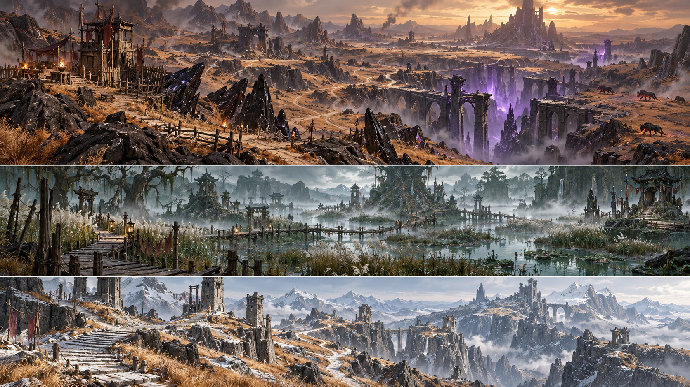

# World, regions and hunting routes

## Briarwood March — existing region, levels 1–25

Briar Crossing / Waystone Refuge is the safe center: keeper, merchants, smith and stables within a short walk of the departure road. Roads branch into increasingly dangerous hunting grounds. The map should show discovered landmarks and level bands without revealing every hidden Fracture immediately.

| District | Current suggested band | Main hunting identity | Route function |
| --- | --- | --- | --- |
| Refuge / Briarwood Verge | 1–7 | Mosslings and the first preparation loop | Teach supplies, cleaving, quarters and smithing |
| Outer Meadows | 1–5 | Meadow/Blue/Red Wolves, Bristle Boars, Reed Spiders | Short introductory material circuit |
| Wolfwood | 6–9 | Grey Wolves, Mire Boars, Copper Spiders, Moonfang, Road Bandits | First leader hunt and better gear |
| Hollow Highlands | 10–13 | Thicket Wolves, Blacktusk, Venom Spiders, Slate Guardian, raiders | Mixed-threat route with a stronger Fracture |
| Ashen Reach | 14–17 | Cinder Wisps, Frost Wolves, Ironhide, Silk Matron, Ash Bandits | Practice ranged pressure and boss telegraphs |
| Dusklands | 18–20 | Grave Wisps, Cairn Sentinels, Dusk Stalker, Bloodfang | Long prepared pulls and rare gear chase |
| Ancient March | 21–25 | Obsidian Boars, Widow Spiders, Exile Captain, Storm Wisps, ancient stone bosses | First-region climax and high-tier recipes |

Old Pine Hollow and the Broken Cairn remain memorable landmarks. Briarwake sits on a visible side trail east of the hollow. Natural ridges, tree clusters and road markers orient the player without forcing a single corridor.

## Cinderfall Basin — existing region, proposed expansion 18–35

The existing basin has a scout outpost, Ember Hound Den, Glass Spider Nest and the Broken Rift. Its present mobs are levels 18, 19, 21 and 25. Expanding the basin toward level 35 requires new level-banded variants and rewards; the art board does not imply those encounters already exist.

Make black glass ridges and a fractured rift the major silhouettes. Keep ember light local, use walkable dusty shelves between dangerous pockets, and connect each hunt to a road back to Scout Vela. Ashwake is the proposed repeatable mastery core for this region.

## Future regions

| Region | Proposed levels | Environment | Repeatable goal | New enemy concepts |
| --- | --- | --- | --- | --- |
| Greywater Fen | 26–40 | Shallow water, raised timber paths, reeds and drowned shrines | Recover routes and destroy drowned Fractures | Reedbound stalkers, mire wardens, drowned charm wisps |
| Crownless Heights | 35–50 | Wind-worn stair roads, slate cliffs and fallen watchtowers | Crownwake mastery circuits and final relic construction | Ridge exiles, storm cairns, Crownless Warden boss |

New creature rows need level, tier, EXP and explicit per-item probabilities before runtime implementation. Current tables cover only current resources; never label speculative monsters as shipped enemies.

## Placement rules

Each district needs a safe approach, a compact regular-mob loop, a harder leader branch, one landmark and an optional return shortcut. Put dangerous pulls on broad terrain where their attack arcs are visible. Avoid dense foliage across the fight floor, invisible cliff collision and roads that accidentally cross several aggro regions.

Fractures should be reachable from two directions with open warning-ring space and a nearby ordinary hunting loop. Place rare leaders where players can choose the encounter. Bridges need enough width for horse travel and clear rails. Sightline changes reveal landmarks gradually; fog separates distance rather than hiding immediate hazards.

## Travel and discovery

Travel on foot remains viable. The trail horse increases travel efficiency; it is not a mandatory gate to quest completion. Keep region boundaries explicit and safe at spawn. Future waystone travel unlocks through discovery and a small gold fee; do not assume it is already implemented because a keeper exists.
