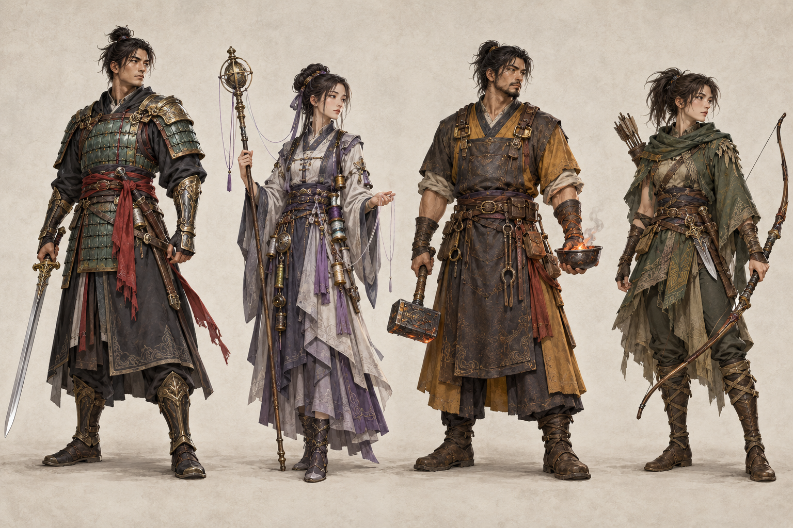

# Classes, specializations and combat

The lineup is **Ironvow, Threadseer, Cinderhand, Fenstrider**. Each has two different six-ability specializations. The current runtime supports Ironvow / Turnwarden; the remaining paths are design targets described in the existing class design.

## Class identities

| Class | Weapons | Suggested allocation | Two paths and their decisions |
| --- | --- | --- | --- |
| Ironvow | Swords; future two-handed blades | STR/VIT, some AGI | Turnwarden earns one short Answer from a frontal guard; Redmarch advances, crosses or surrenders a moving front |
| Threadseer | Focus rods; future throwing needles | DEX, then VIT/AGI | Knotbinder links two enemies and responds to separation; Farlistener decides whether to spend a visible echo |
| Cinderhand | Staves and hammers | DEX/VIT; STR for melee basics | Hearthwright builds and abandons a fueled work site; Ashreckoner accepts bounded vulnerability, then vents or spends it |
| Fenstrider | Bows, short blades, living staves | AGI/DEX, useful VIT | Reedstalker holds or abandons a firing lane; Briarchanter cultivates and harvests at most two visible growths |

The stat tendencies are recommendations, not allocation restrictions. One player can choose survival over maximum damage. No undocumented mana or INT stat is required by this design.

## Turnwarden — current ability baseline

Values below are current skill definitions, treated as rank-1 comparison values for the proposed mastery system. `A` is the attack power used by the skill before target mitigation.

| Ability / persistent ID | Current effect | Cooldown |
| --- | --- | ---: |
| Thunder Cleave / `riving_stroke` | 130° frontal arc, 4.2 m, 1.8A; Open grants +25% basic damage for 4s | 3s |
| Spirit Edge / `held_line` | +45% basic damage, +30% attack speed for 6s; guard a frontal blow by 65% for 2s to earn Answer | 12s |
| Flashstep / `heelturn` | Collision-respecting 5 m dash; +80% movement for 4s; short slowing wake | 6s |
| Bladestorm / `gate_sweep` | Moving 4 m circle; .9A opening + four .55A pulses; slow; Answer adds opening push | 7s |
| Phoenix Ring / `standard_of_ash` | 3.8 m field for 4s; .5A every .5s; 25% slow; 25% damage reduction while inside | 10s |
| Sunbreaker / `due_return` | 110° arc, 4.5 m, 3A and 1 m push; .35A heal on hit; Answer adds .5A damage and .6A heal | 8s |

Use the detailed [existing class document](../../CLASS_DESIGN.md) for the 48 ability designs and their exact counterplay. The new mastery layer multiplies listed potency once; it does not replace those identities with a universal builder/spender meter.

## Encounter decisions

Basic combat should remain effective without following a mandatory six-skill sequence. Draw a pack into a readable arc, decide whether to hold a frontal attack or reposition, and use an area ability when the geometry is favorable. Gear improves kill time and survival; it cannot remove every positional risk.

Enemy attacks use a clear windup, active contact window and recovery. A wolf commits to a forward bite/lunge, a boar to a short charge, a spider to a low fan or venom tell, a bandit to a human blade arc, a stonekin to a slow heavy slam, and a wisp to a visible ranged pulse. Elite attacks combine these with clearly announced space hazards.

Hit feedback follows real contact: a brief material impact, sound, target reaction and readable damage number. Healing on hit requires a real eligible target hit. An animation or flash alone cannot grant damage, healing or mastery progress.

## Death and recovery — proposal

Death returns the character to the last refuge with no loss of learned stats, mastery or equipment. Lose 5% of carried gold, capped at 500, and remove any unclaimed personal ground loot. No XP loss is proposed: quarter milestones cannot be repeatedly removed and re-earned. Keep smithing destruction as its own explicit item-loss rule.

## Balance review

Compare ordinary +3 gear, good +6 gear and rare +9 gear at the same level. Measure kill time, incoming damage, recovery stops and maximum safe pull size. Test mixed melee/ranged packs and the actual third-person camera. Damage values alone cannot establish that a build or encounter is fair.
