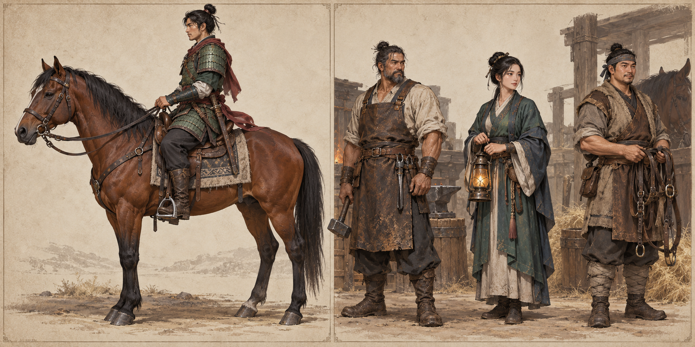

# Mounts, tack and the mounted pose

## Trail horse — current baseline

The ordinary Briarwood horse is a bay brown horse with dark mane, tail and lower legs. Its current speed is **8.8 m/s**; the Trail Bridle costs **240 gold** at Bram's Stables. The current runtime supports travel, mounted basics and a mounted-pose presentation. Horse unlocks are persistent, separate from a single inventory item's visual attachment.

The horse should look like a real riding horse at gameplay distance: strong chest and hindquarters, a narrower flank, four separate planted hooves, a modest elongated head, and a neck that carries the head naturally. Avoid an oversized head, short dog-like body or pencil-thin limbs. The rider is an adult seated over the saddle, with thighs around the barrel, bent knees and heels beneath the pelvis.

## Rider and tack requirements

Refine the rider's anatomy and equipment separately before adjusting the mounted pose. Shoulders and boots must fit the body; split cloth must clear the seat and thighs. Fit a leather saddle to the back above a wool blanket. Add a believable girth, bridle, reins and hanging stirrups. Feet rest at the stirrups and hands meet the reins through idle, walk and canter.

Do not raise the saddle to compensate for a poorly scaled rider. Keep horse, rider and tack dimensions consistent. A rider's legs must not disappear into the horse, and reins must not pass through its neck. Mounted weapon placement should clear the horse and show an identifiable grip.

## Review before accepting a model

Render and **open** front, side and three-quarter images for the horse alone, rider alone and mounted pair. Inspect limb proportions, saddle fit, knee angle, boot contact, rein contact and cloth clipping. Export the final materials and inspect those same views inside Godot, then review actual travel and mounted combat.

The previous asset review and engine captures live in [horse reference review](../../docs/HORSE_REFERENCE_REVIEW.md). The concepts here define future consistency; generated illustration alone cannot validate an exported mesh or animation.

## Proposed later mount progression

| Mount | Unlock source | Role | Visual direction |
| --- | --- | --- | --- |
| Trail horse | Bram's ordinary bridle | Accessible early travel | Bay coat, plain leather tack |
| March courier | Level-20 road quest plus gold | Quicker long-route travel, bounded speed | Lean horse, lighter blanket and saddle bags |
| Cairn destrier | Regional achievement and crafting | Stable mounted-combat platform | Heavier realistic horse, restrained fitted lamellar tack |

Do not introduce faster mounts without checking navigation, bridges, camera follow and combat reach. A mount changes speed and supported attack policy, not the player's loot-level factor. Armor/tack with stats can use +9 equipment rules; coat colour and a mount-unlock token do not.

## Travel interactions

Block mount/dismount where there is no valid ground placement. Dismounting preserves HP, gear and cooldown state and does not escape an active hit. Town travel, narrow paths, zone transitions and respawning all need a defined mount state. Later region waystones require discovery and an explicit fee; the keeper's presence alone is not proof of implemented fast travel.
